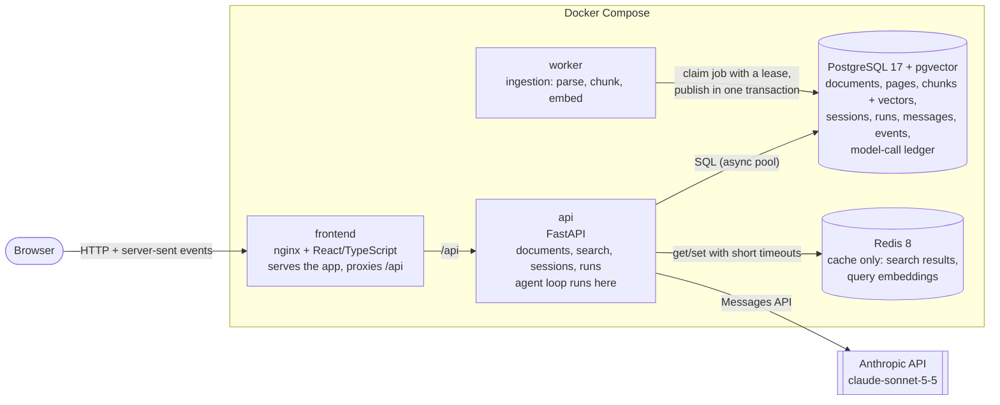
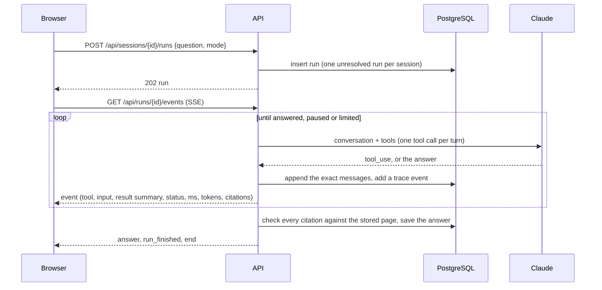
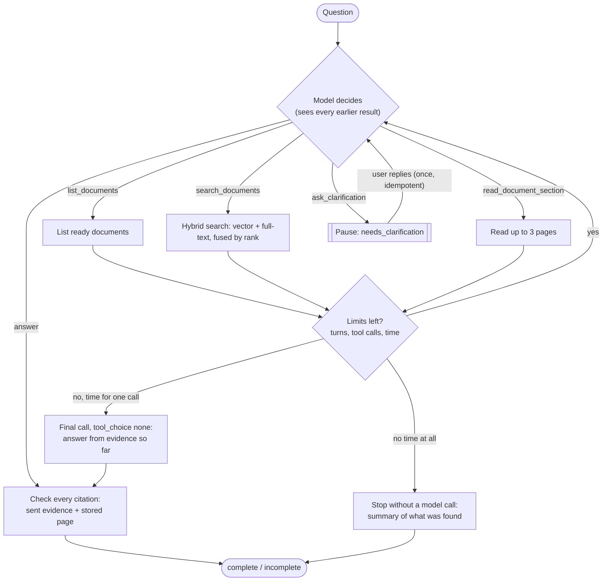
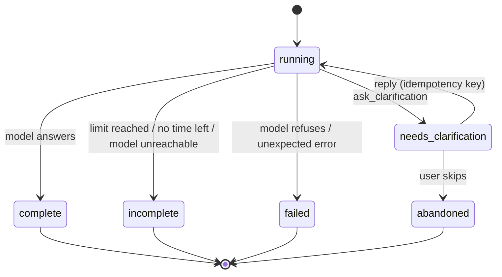

# Architecture

An agentic RAG application over a small set of text-based PDFs (8 to 15) from one domain. Users upload documents and ask simple or multi-part questions; an agent chooses tools, looks at what they return, and decides whether to search again, read more, ask the user to clarify, or answer with document and page citations that are checked in code.

## Components

| Service | Job | Scales by |
|---|---|---|
| `frontend` | Static React app; nginx proxies `/api` to the API (same origin, no CORS) with buffering off for event streams | Any number of replicas |
| `api` | REST endpoints; runs each question as a background task; embeds queries with the local model | More replicas once live events move to Redis pub/sub and runs to a queue (see Scaling) |
| `worker` | Ingestion jobs: parse each page with pypdf (in a child process with time and memory caps), split pages into passages of about 350 model tokens, embed with fastembed `BAAI/bge-small-en-v1.5` | More replicas: jobs are claimed with `FOR UPDATE SKIP LOCKED` and a lease |
| `postgres` | System of record for everything, including raw PDFs and the exact model conversation of every run | Vertical, then read replicas and an ANN index |
| `redis` | Cache. The app works without it | Vertical; it holds nothing that cannot be rebuilt |

## How a question is answered

## The agent loop and its decision points

The result-driven change of action is the point of the loop: after each tool result the model decides again. In the recorded runs it narrows a search to one document after `list_documents`, rewrites a query when results miss, reads whole pages when a list is cut off or when search keeps failing, and asks which document the user means instead of guessing.

### Tools

| Tool | Input (validated) | Success | Empty | Errors |
|---|---|---|---|---|
| `list_documents` | none | JSON: id, title, pages | `{"status":"no_results"}` | |
| `search_documents` | `query` (1-500 chars), `document_ids`, `page_from`, `page_to`, `top_k` 1-10 | citable `search_result` blocks | `{"status":"no_results","query":...,"hint":...}` | `is_error` + `{"status":"invalid_input"\|"error"\|"timeout",...}` |
| `read_document_section` | `document_id`, `page_start`, `page_end` (at most 3 pages, must exist) | one citable block per page | `{"status":"no_results"}` | as above |
| `ask_clarification` | `question`, `options` | pauses the run | | invalid input is returned to the model |

Read tools only run parameterized SQL over the indexed corpus. None can write, call the network or touch the file system, so an instruction hidden in a document has nothing to act on.

### Agent state

Everything about a run is in PostgreSQL, so a run survives a restart of the browser and, when paused, of the server:

| Table | Holds |
|---|---|
| `runs` | question, mode, status and reason, answer with checked citations, turn and tool-call counts, execution time, pending clarification id, resume key |
| `run_messages` | the exact model conversation, append-only (including thinking blocks, which are never shown) |
| `run_events` | the trace the UI shows: each tool call with input, result summary, status, time, cache status, retries and retrieved pages; each model turn with tokens and cost |
| `llm_calls` | every model call: tokens, cache reads and writes, estimated cost, stop reason, request id |

### Run states and stopping conditions

| Stop | Default | What happens |
|---|---|---|
| Model answers | | `complete` |
| Tool calls | 9 | after the 9th call, one final call with `tool_choice: none` answers from the evidence so far; `incomplete` |
| Model turns | 10 | the 10th turn is that final call |
| Run deadline | 90 s, of which 20 s reserved for the final answer | with 20 s or less left, a requested tool is answered "not run" and the final call follows; with under 5 s left, stop with a summary and no model call |
| Tool timeout | 8 s, one retry | the failure goes back to the model as a typed error; it can rewrite the call or use another tool |
| Model API unreachable | SDK retries within the call's time budget | `incomplete` with the reason |
| Model refusal | | `failed` |

## Retrieval and citations

- **Ingestion**: page by page with pypdf. Pages keep their physical number (what a PDF viewer opens with `#page=N`). Each page is split on sentence boundaries into passages of about 350 tokens of the embedding model, with about 50 tokens of overlap, never crossing a page. Text is embedded and indexed with a header (document title and page), so a query that names a document finds it even when the body is noisy OCR; the original text is what the model sees and quotes.
- **Search**: exact cosine similarity (pgvector) and PostgreSQL full-text (`websearch_to_tsquery`, ranked by `ts_rank_cd`) over the same filtered candidates, each taking its top 30, fused with reciprocal rank fusion (k=60). Exact on purpose: at a few thousand passages a scan takes milliseconds, and filters can never under-fill results the way an approximate index can. `ts_rank_cd` is cover-density ranking, not BM25.
- **Citations**: passages reach Claude as `search_result` blocks with citations enabled, split into groups of a few sentences so a citation quotes only what it needs. Each returned citation is checked: it must point at evidence this run actually sent (index across the whole conversation, source, quoted blocks), and the quote must appear on the stored page. The UI shows the quote, the check result and a link to the page.

## Redis

| Key | Holds | TTL and invalidation |
|---|---|---|
| `search:v1:{corpus_epoch}:{corpus_version}:{model}:{hash}` | results for a query, filters and `top_k` | 10 min. `corpus_version` increases in the transaction that publishes a document; `corpus_epoch` is a random id per database, so a recreated or restored database never reads old entries |
| `qemb:v1:{model}:{hash}` | a query's embedding | 24 h; keyed by model |

When Redis is down, reads count as misses, writes are skipped, Redis is not retried for 30 seconds, the trace shows `cache unavailable`, and `/api/ready` reports `degraded`. Answers keep working. Sessions, jobs and locks are deliberately not in Redis: PostgreSQL already has them durably, and a cache must be safe to lose.

## Safety

- **Untrusted text**: passages are evidence, never instructions (stated in the system prompt, tested with a planted instruction). Tools are read-only and corpus-only, so even a followed instruction could not act.
- **Limits**: listed above; all configurable through environment variables.
- **Session isolation**: a random capability token in an HttpOnly, SameSite=Strict cookie; sessions and runs belong to its hash, other browsers get 404, and a run must belong to the session in the URL. Documents are shared on purpose (single-tenant demo).
- **Uploads**: PDF magic bytes, 25 MB, 600 pages, duplicate detection by SHA-256, file names reduced to safe ASCII before reaching a header, parsing in a child process with time and memory caps.
- **Secrets**: only in `.env` (git-ignored); CI uses no API key.
- **Failure messages**: users see a plain cause and a reference; exception text stays in the server log.

## Design decisions and trade-offs

| Decision | Why | Trade-off, and when to revisit |
|---|---|---|
| Plain tool-use loop, no agent framework | One agent, four tools: the loop is under 300 lines with every step visible; nothing hidden to debug live | LangGraph would add checkpointing and graph tooling; worth it with several cooperating agents or long-lived workflows |
| Claude's native `search_result` citations | Quotes can only come from evidence sent; no extra output format to parse | Provenance is guaranteed, support is not: checked by evaluation |
| One tool call per turn | Simple ordering; a clarification is never mixed with other calls | More turns and latency on multi-part questions; enabling parallel calls needs batch handling and new tests |
| Exact vector search, no HNSW | Correct and fast at this size; filters never under-fill | Add HNSW (and test filtered recall) past roughly 100k passages |
| PostgreSQL owns ingestion jobs | Durable, transactional, one less moving part | A real queue (or Redis streams) for many workers or priorities |
| Redis as a cache only | It can fail without losing anything | Shared rate limits and live events across API replicas would move to Redis |
| SSE by polling `run_events` | Works across refresh and reconnect; survives a page reload with `Last-Event-ID` | Polls every 0.4 s per open stream; Redis pub/sub at higher concurrency |
| Runs as background tasks in the API process | Simple; state is in PostgreSQL | Assumes one API instance (startup closes interrupted runs); a worker queue for runs when scaling out |
| Local embeddings (bge-small, 384-d) | Free, private, reproducible, no extra key | Smaller model; a hosted embedding model or a reranker for harder retrieval |

## Scaling path

1. Several API replicas: move live events to Redis pub/sub, and runs to a queue consumed by run workers, so no run depends on the process that accepted it.
2. More documents: add an HNSW index and measure filtered recall; partition chunks by collection; move raw PDFs to object storage.
3. Better retrieval: contextual chunk headers generated at ingestion, a cross-encoder reranker, BM25 (for example ParadeDB) in place of `ts_rank_cd`, each kept only if the evaluation shows a gain.
4. Multi-tenant: authentication (NYU SSO), tenant id on documents and sessions, row-level security.
5. Kubernetes or OpenShift: the five services map directly to Deployments (frontend, api, worker), a managed PostgreSQL and Redis; the health and readiness endpoints already exist.
